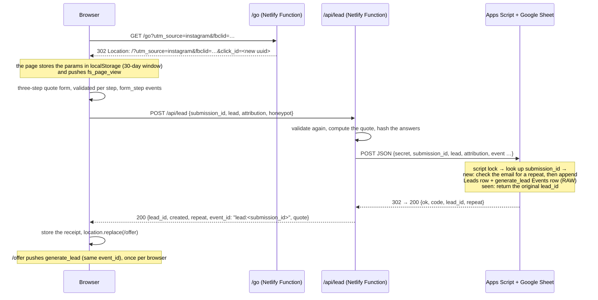

# FernSure

**We've been trying to reach you about your fern's extended warranty.**

FernSure is a parody houseplant-warranty company. It runs a real lead-gen funnel, with a joke in every field. A visitor clicks a fake ad and answers three questions about how badly they treat their plant. Then they get a "personalized" quote.

Every allowlisted UTM, click ID and affiliate sub-ID that arrived with the visitor survives the trip. It passes through a server-side redirect and a validated multistep form, and lands in the lead record. Delivery to the "CRM" (a Google Apps Script endpoint writing to a Google Sheet) is idempotent: retries and replays can't create a second lead. Someone who comes back with the same email within 30 days still gets a quote, but their lead is flagged as a repeat. Browser events and server-side event records share an `event_id`.

In lead-gen terms:
- every lead arrives with the source a buyer or affiliate network would pay on;
- a double-click or retry never becomes a duplicate lead, a double payout or an inflated CPL;
- a person who comes back with the same email within 30 days is flagged as a repeat lead, so nobody is billed or paid out for them twice.

**Live demo:** [fernsure.netlify.app/ads](https://fernsure.netlify.app/ads). Click an ad, get a quote, then open **"What we know about you"** (the panel button, bottom right) to watch the tracking.

> **About this repository.** It holds this write-up and four excerpts from the code. The server code (three Netlify Functions and the Apps Script endpoint), the 281 automated tests and the planning documents are private and available on request. The browser code is whatever the live site serves. Portfolio demo: no warranty is offered, nothing is sold, and the form only accepts `example.com`-style test addresses.

---

## Try it in two minutes

**No DevTools needed:**

1. Open [/ads](https://fernsure.netlify.app/ads) and click any of the fake ads. The home page says "Ad click recorded".
2. Click **Get my quote**, then **Use sample details**. It fills every answer except the consent box. Click **Next**, **Next**, tick the consent box on step 3 yourself (it's never pre-ticked), then click **Get my quote**.
3. You land on your quote certificate. Open **"What we know about you"**: it shows your attribution, the events with their `event_id`s, and the server's receipt. Press **Activate coverage** to record a second server-side event.
4. In the panel, press **Replay last submission**. The server answers *duplicate* with the same `lead_id`, and no second lead is created.
5. **To see a repeat lead,** get two quotes with the same email address.
   - **Use sample details** gives every fill a fresh address, so type one yourself both times. Pick one nobody else is likely to have used, such as `test+<your name>-<a number>@example.com`.
   - The second certificate says the lead was filed as a repeat. In the panel's *Server receipts*, the *Repeat lead* line says yes.
   - Both quotes are saved as separate leads, unlike the replay in step 4.

Try a real email address or a future watering date on the form to see the validation.

**With DevTools** (turn on **Preserve log** in both the Network panel and the Console):

- Network: `GET /go?…` answers **302** with `Location: /?…&click_id=…`. Values are re-encoded, so `%20` may show as `+`.
- Console: `fs_page_view`, `form_step` (twice), `generate_lead` with `event_id: "lead:<submission_id>"` and `repeat: false` (`true` for a repeat lead), and `activate_coverage` after you activate.

## What it shows

| What | Where to see it | Code |
|---|---|---|
| Tracking params survive a redirect | `/ads` → any ad → "Ad click recorded" | [excerpt 02](excerpts/02-go-tracking-link.mjs) |
| Attribution rules: last tagged click, a 30-day window that restarts at each tagged click, first touch kept | The panel → *Your attribution* | [excerpt 01](excerpts/01-attribution-rules.js) |
| Multistep form with per-step validation, loading, error and retry states | `/quote` | served by the live site |
| The server re-validates and computes the quote; the browser isn't trusted | The certificate shows the formula the server used | private |
| Idempotent lead delivery | The panel → **Replay last submission** | [excerpt 03](excerpts/03-apps-script-idempotency.gs), [excerpt 04](excerpts/04-lost-response-test.mjs) |
| Repeat leads flagged, not blocked: same email within 30 days | Two quotes with one email → the certificate's repeat note, and the panel → *Server receipts* → *Repeat lead* | [excerpt 03](excerpts/03-apps-script-idempotency.gs) |
| Browser and server events matched by `event_id` | The panel → *Events in this tab* and *Server receipts* | [excerpt 03](excerpts/03-apps-script-idempotency.gs) |
| Fast and accessible | Lighthouse mobile on `/`, `/ads` and `/quote` (local build): Performance 98–99, Accessibility 100, Best practices 100 | — |

---

## How tracking flows

<strong>Step by step, and where each identifier goes</strong>

1. **The ad link is a real tracking link.** `/go` answers with an HTTP **302**, not a JavaScript redirect, because that's what affiliate networks and click trackers do. It keeps only allowlisted params and adds a fresh `click_id`, which plays the part of a network's transaction ID. Because it's a real redirect, the landing page still sees the original referrer.
   - Google Ads' parallel tracking fetches a tracking template in the background and sends the visitor straight to the final URL. So for Google traffic, `/go` would have to be the final URL for its `click_id` to reach the page; `gclid` arrives through auto-tagging either way.
2. **The landing page captures attribution** in `localStorage` as the *last tagged click*, with a 30-day window that restarts at every tagged click.
   - Only a visit carrying an allowlisted UTM, click ID or affiliate param counts as a touch. Untagged visits (direct, organic search, untagged referrals) never overwrite it. This is the affiliate-network rule, not GA's last non-direct click.
   - A new tagged visit replaces the whole record, so an old `fbclid` can't ride along on a Google click.
   - Reloads and Back/Forward don't count as new clicks.
   - The first touch is kept separately.
3. **The form carries the attribution.** Hidden inputs named exactly like the params mirror it, so the Elements panel shows the values. The request body is built from storage at submit time.
4. **The function re-validates everything** with the same shared rules the browser uses. It recomputes the quote, rebuilds the attribution field by field, and forwards the lead. The shared secret travels in the JSON body, because Apps Script's `doPost(e)` can't read request headers.
5. **Apps Script takes a script lock and checks the `submission_id`:**
   - A new submission gets its lead row and its `generate_lead` event row in the same execution. They're written in Sheets API **RAW** mode, so `=1+1` stays text and ZIP `02134` keeps its zero.
   - A retry or replay of the same submission returns the original `lead_id`. If an earlier attempt saved the lead but failed before its event row, the retry writes that row.
   - Different answers under the same ID are refused.
   - A new submission is also checked against earlier leads. If the same email (trimmed, lowercased) produced a lead from the same deploy context in the last 30 days, the new row is saved with `repeat_of`, and its event row is marked `suppressed_repeat`.
6. **The certificate page (`/offer`) pushes `generate_lead`** with the same `event_id` as the server row when it loads. It also carries `repeat`, so a tag manager can keep a repeat lead away from paid-platform tags. The form doesn't push it just before it navigates, because a tag fired on it could be cancelled by the unload. **Activate coverage** records a second server-side event, `activate_coverage`, whose attribution is copied from the lead row rather than taken from the request.

| Identifier | Captured | Stored | Ends up in |
|---|---|---|---|
| `utm_source/medium/campaign/term/content/id` | landing URL after `/go` | `localStorage` (30 days) | Leads and Events columns, dataLayer |
| `gclid`, `gbraid`, `wbraid`, `msclkid`, `fbclid`, `ttclid` | landing URL | same | columns; `fbclid` also becomes `fbc` in the dry-run Meta payload |
| `aff_id`, `sub1`–`sub5` | landing URL | same | columns, plus the dry-run affiliate postback URL |
| `click_id` | minted by `/go` | same | columns, plus the postback |
| `submission_id` | minted by the form, reused for identical retries | session storage, in the last request body (kept for **Replay last submission**) | the Leads row (the idempotency key) |
| `lead_id` | minted server-side | session storage | Leads, Events, the certificate page |
| `event_id` | `lead:<submission_id>`, `activate:<lead_id>` | `localStorage`, the IDs already pushed, so each is pushed once per browser | dataLayer **and** the Events row |
| `repeat_of` | set by Apps Script when the email produced a lead in the last 30 days | — | the repeat's own Leads row only, holding the `lead_id` of the chain's first lead (empty for a lead that isn't a repeat). The browser gets only `repeat: true/false`, never another lead's id |

Values are kept byte for byte: decoded once and never trimmed or re-cased. A value over 512 characters, or one containing control characters, is dropped rather than truncated.

### What "deduplication" means here

Three different guarantees, kept separate on purpose:

- **Idempotent delivery.** The same submission sent twice creates one lead. That covers a double-click, the automatic retry after a lost response, or the panel's Replay. The case that matters: the first write succeeded, its response was lost, and the retry still produced one lead. [Excerpt 04](excerpts/04-lost-response-test.mjs) is the test for it.
- **Repeat leads.** A *new* submission from an email that already produced a lead in the last 30 days is a different case: one person coming back. It's saved, so the visitor still gets a quote. But the Leads row records `repeat_of` (the first lead of the chain), and its Events row is marked `suppressed_repeat`, so its dry-run conversion payloads would not be sent. Lead buyers flag repeats the same way, so one person isn't billed or paid out twice. [Excerpt 03](excerpts/03-apps-script-idempotency.gs) has the code.
  - A chain continues while each lead is within 30 days of the one before.
  - Only leads from the same deploy context are compared, so a preview test can't flag a production lead. The most recent lead is chosen by `received_at_utc`, not row position, so sorting the tab can't change the answer.
  - The browser hears only `repeat: true` or `false`, never which lead it repeats. Two strangers can type the same test address, and a `lead_id` is all it takes to activate a lead.
- **Event matching.** The browser's `generate_lead` and the server's Events row share one deterministic `event_id`. That's the key Meta uses to merge Pixel and Conversions API events (same `event_name` and `event_id` within 48 hours). In a real setup, a GTM Meta Pixel tag would fire Meta's standard `Lead` on the `generate_lead` dataLayer event, with `eventID: {{event_id}}`, when `repeat` isn't `true`. That matches the dry-run CAPI `Lead` event.

  No Pixel is loaded and nothing is sent to an ad platform: the dataLayer is GTM-ready instrumentation, and the server payloads are stored as **dry runs**. GA4 does not deduplicate by event ID, so a real GA4 setup would send each lead event from one channel only.

## The excerpts

| File | What to look for |
|---|---|
| [01-attribution-rules.js](excerpts/01-attribution-rules.js) | The whole attribution policy as pure functions: last tagged click, whole-record replacement, a sliding 30-day window, first touch kept, reloads ignored, malformed storage rejected. |
| [02-go-tracking-link.mjs](excerpts/02-go-tracking-link.mjs) | A tracking link in about 40 lines: a real 302 with a relative `Location` (no request data can choose the host), allowlisted params only, a fresh `click_id`, `no-store`. |
| [03-apps-script-idempotency.gs](excerpts/03-apps-script-idempotency.gs) | The CRM side: • the secret checked before the lock, then one script lock; • lookup by `submission_id`, with a payload hash so changed answers can't reuse an ID; • repair of a missing event row; • repeat-lead flagging: same email and deploy context, within 30 days of the latest lead, chained to the first one; • event rows that copy attribution from the lead row, with a repeat's payloads marked `suppressed_repeat`; • RAW writes built by header name. |
| [04-lost-response-test.mjs](excerpts/04-lost-response-test.mjs) | The tests that pin it down: three identical replays give one lead, and a lost response followed by a retry still gives exactly one lead. |

## How it's tested and verified

- **281 automated tests** (`node:test`) plus a type check run on every Netlify build, and a failing test blocks the deploy. They cover attribution, validation, the quote engine (all 40 plant × habit combinations), the functions, repeat-lead flagging, and cross-area integration.
- **The real Apps Script runs in the tests.** `Code.gs` runs inside a Node `vm` against a small fake of the Google APIs it uses, with fault injection: a lost response, a timeout, an HTML error page, a busy lock. The tests exercise the code that ships to Google, not a lookalike mock.
- **Checked live on production:**
  - a smoke test against the real Apps Script and Sheet passes 8/8:
    - the 302, and params kept with a fresh `click_id`;
    - a new lead, and the server's repeat check on it;
    - an identical replay with the same `lead_id`;
    - a second submission from the same email, flagged as a repeat;
    - activation, and a duplicate activation;
  - the per-IP rate limit answers 429 after a burst;
  - the security headers are present (CSP, `frame-ancestors 'none'`, `nosniff`, `noindex`).
- **AI code reviews.** Before launch, separate Claude Code review passes looked for defects, and a skeptic pass had to confirm each finding before it was fixed (18 were). One of them, a header write that would have failed on a brand-new Google Sheet, was caught before it reached production. A later review of the repeat-lead change found two problems in its first version, and both were fixed before release:
  - it sent the earlier lead's `lead_id` to the browser;
  - it depended on row order.
- **Not automated:** the browser-side DOM wiring has no browser test suite. It was checked by hand in a real browser, including the lost-response retry against a simulator that drops the reply.

## What's real, what's faked, and what I'd change at scale

**Real:**
- the 302 tracking link;
- attribution capture and storage;
- the form, its validation and its error handling;
- server-side validation and pricing;
- idempotent delivery to a third-party endpoint with a shared secret, a lock and literal writes;
- repeat-lead flagging by email over a 30-day window;
- deterministic event IDs;
- per-IP rate limits (10 leads and 20 activations a minute), a honeypot, a daily cap and security headers.

**Faked:**
- the insurance;
- the ad platforms (the click IDs are made up and can't match a real click);
- outbound conversions (the Meta CAPI and affiliate-postback payloads are built and stored as dry runs, never sent);
- email (none is ever sent, and only reserved test domains are accepted);
- payments.

**Known limits:**
- Safari's tracking prevention can cap script-written storage at 7 days, so the 30-day window is best-effort there.
- Safari Private Browsing, Mail and Messages can strip click IDs such as `fbclid` and `msclkid` (Apple publishes no list), and Brave also strips `gclid`.
- Email security scanners can prefetch tracking links, so a production system counts a click only when the landing page runs.

**At scale I would:**
- set attribution in a server-side, HttpOnly first-party cookie;
- put a queue between the function and the CRM, and replace the Sheet with a real CRM and lead-distribution system;
- send the Meta Conversions API payload and the affiliate postback for real, and add Google Ads offline conversion uploads keyed on `gclid`/`gbraid`/`wbraid`, behind a consent check and with server-side GTM;
- add TrustedForm or Jornaya certificates for consent evidence;
- match repeat leads on phone as well as normalized email, including leads from other vendors and systems, and check them against buyers' suppression lists.

## Built with

Static HTML, Tailwind CSS v4, vanilla JavaScript ES modules type-checked with `tsc`, Netlify Functions on Node 24, Google Apps Script and Sheets, and `node:test`. There are no runtime dependencies.

**How I used AI.** I wrote the original brief. Claude Code critiqued it with several independent reviews and checked about 120 platform claims against the official docs. That surfaced real problems in my plan: Apps Script can't read request headers, a JavaScript redirect isn't a 302, and `appendRow` rewrites ZIP codes. Claude Code then wrote most of the code to the reviewed plan, and I approved the design decisions. The private repository includes the brief, the reviewed plan and a dated decision log recording who proposed and who approved each decision. That includes AI suggestions that were declined, and an AI reviewer's claim (a 10-second Netlify function timeout) that a fact-check against the Netlify docs overturned.

## Full source

The server code, tests and planning documents are in a private repository. If you're reviewing my application and would like to read them, contact me using the details in my application and I'll give your GitHub account read access.

## Copyright

© 2026 Alex Sidlinskiy. All rights reserved. This repository is published for review only and is not open source. See [NOTICE.md](NOTICE.md).
